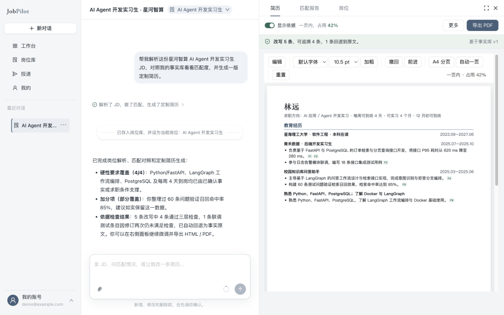
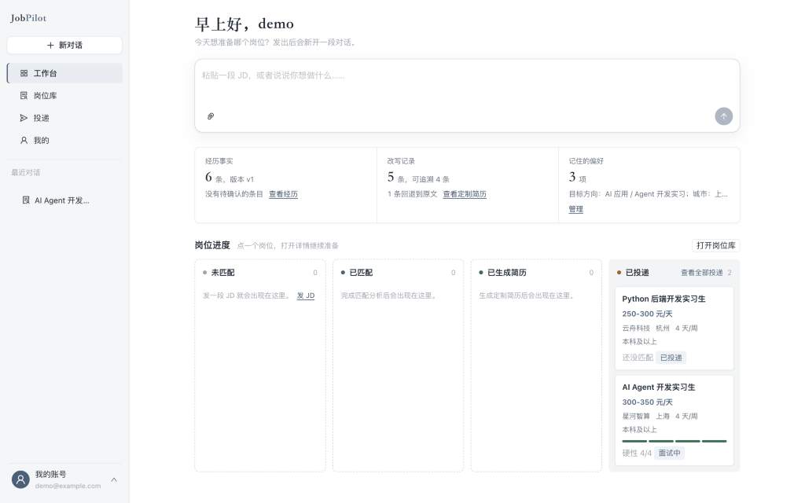
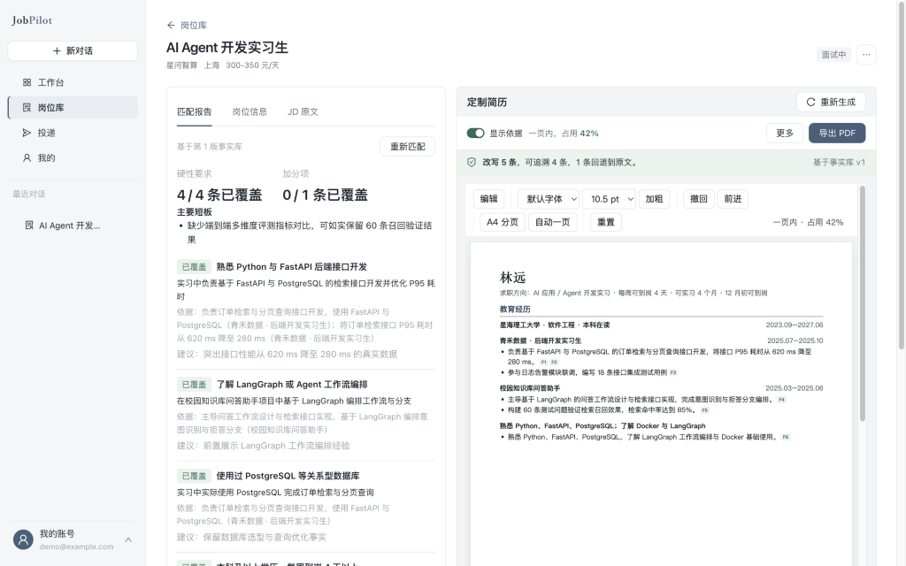
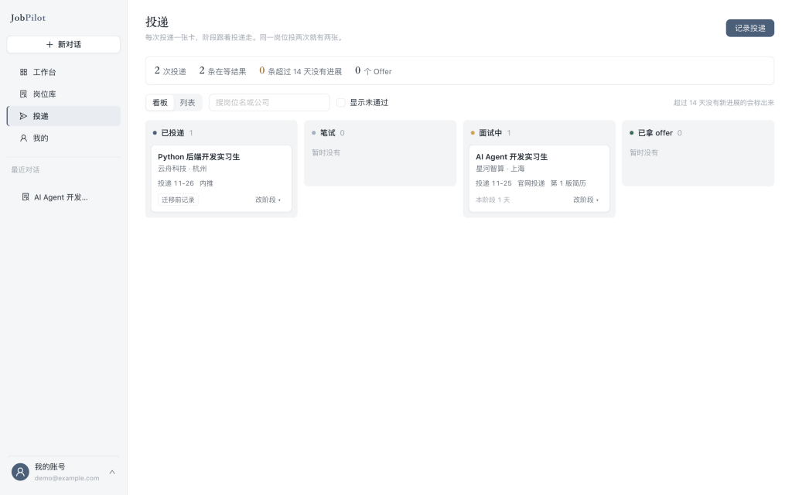
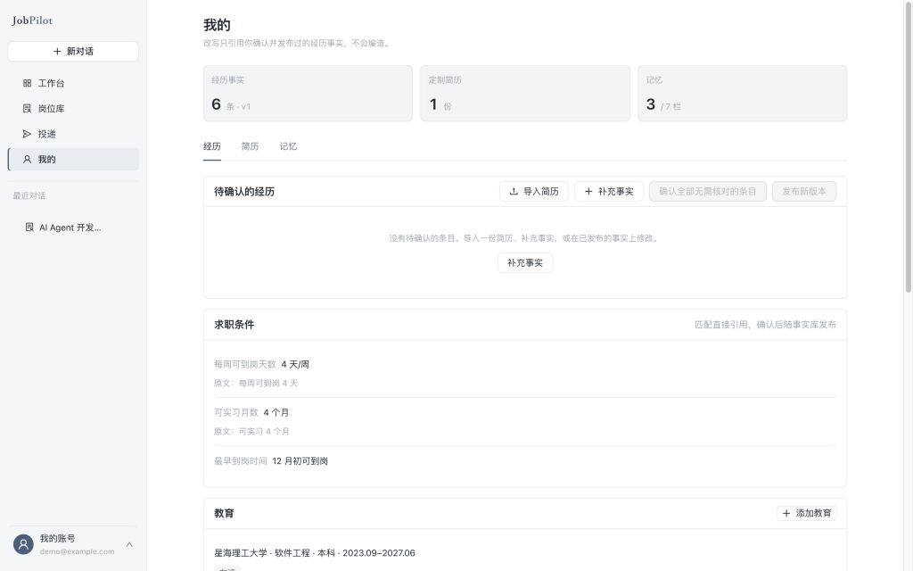
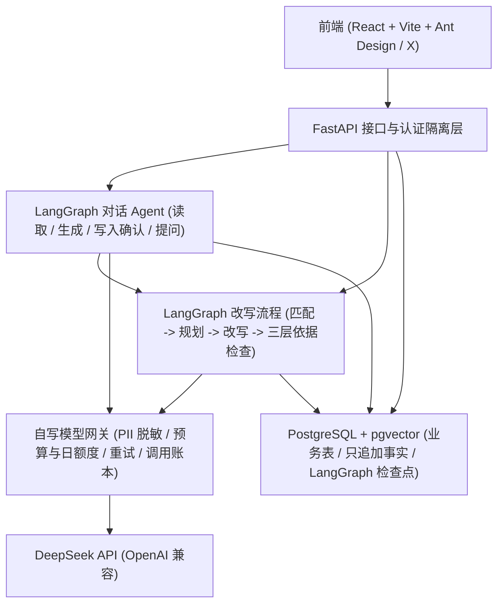

# JobPilot

[](https://github.com/Galilieo/jobpilot/actions/workflows/jobpilot.yml)
[](https://github.com/Galilieo/jobpilot/actions/workflows/web.yml)

**可追溯改写**：面向技术类实习求职的对话式求职助手 Agent——**改写简历时不编造经历**。

> 当前状态（2026-11-27）：**V1 核心功能、跨用户隔离测试与三轮评审修正已完成，正在进行统一离线评测与本人实际使用记录汇总。** 实施明细见 [06 V1 实施任务书](notes/求职助手Agent/06-V1实施任务书.md)。

## 它做什么

通过对话提供简历和岗位 JD，帮正在找技术类实习的学生走完从拆解经历到跟踪投递的全流程。每条改写都必须引用用户确认过的「经历事实」，并经过三层依据检查（结构与出处校验、数字/实体/角色/程度程序规则检查、独立模型语义支持检查），不通过就有限修订或回退到事实原文，不在成品里凭空编造经历。


## 为什么不用通用 Agent

只改一份简历、不在乎细节时，通用对话工具更方便；当你需要**多岗位反复复用经历**、且要求**不编造并可核验**时，两者差异如下（详见 [00 第 1.5 节](notes/求职助手Agent/00-总览与决策.md#15-为什么不用通用-agent2026-11-16)）：

| 维度 | 通用 Agent | JobPilot |
| --- | --- | --- |
| 经历来源 | 对话总结或临时上传，引用范围不可见 | 用户逐条确认的**结构化事实库**（含职责程度与原文定位） |
| 防编造机制 | 仅靠提示词口头约束 | 每句引用事实编号，**三层依据检查**不通过即修订或回退 |
| 写入边界 | 模型可直接总结改写 | 写入类工具**必须用户确认**，支持撤销；拿不准就提问 |
| 多岗位管理 | 散落在不同对话记录中 | 岗位库软绑定、每份简历绑定事实库版本与投递冻结快照 |

## 功能

- **对话页与右侧产物面板**：在左栏对话中贴 JD、看工具执行步骤、确认写入或回答澄清问题，在右栏实时对照匹配报告、编辑定制简历并查看每条改写的事实编号（`F1`、`F2`…）与检查状态。



- **工作台**：集中展示事实库版本、改写通过率、记住的偏好以及跨岗位的进度看板（未匹配 / 已匹配 / 已生成简历 / 已投递）。



- **岗位库与岗位详情**：支持粘贴、文件与多图 OCR 导入 JD，左栏查看要求覆盖与表达缺口并逐格覆盖字段，右栏直接预览、编辑和导出该岗位的定制简历。



- **投递页**：支持看板与列表视图记录每次投递、冻结当时的简历与岗位快照、追踪阶段历史（已投递 / 笔试 / 面试中 / Offer / 未通过）并与当前版本对比风险。



- **我的（经历、简历与记忆）**：按经历分组确认拆分出的原子事实、求职条件（每周天数、实习月数、最早到岗）与教育背景，管理所有定制简历版本与 7 栏偏好记忆。



- **账号设置**：支持查看当前登录邮箱、一键导出业务数据全量归档（含离线可编辑 HTML）以及 7 天恢复期的两阶段账号删除。

## 架构与关键设计



- **写入必须确认**：对话 Agent 的读取与生成工具自动执行，写入类工具（修改简历条目、切换当前岗位、记录投递、写入/删除记忆）一律经 LangGraph `interrupt()` 暂停并落库生成确认卡，用户确认后执行且支持撤销。
- **事实库只追加**：已发布的 `fact`、`fact_set_criterion`、`fact_set_education` 由数据库触发器拒绝 `UPDATE`，每次修订发布生成新版本并保留 `lineage_id` 谱系，历史匹配与改写结果始终可回溯。
- **投递快照冻结**：每次记录投递时在同一事务冻结岗位信息、简历 JSON 与自包含 HTML 快照及所用事实库版本，后续修改或删除岗位、重新生成简历均不影响已投出记录的可查与对比。
- **上下文管理与压缩**：长对话结合滚动工作摘要（带原文消息序号/引文核验）、`read_conversation_history` 按需回溯与模型窗口裁剪，控制 token 开销的同时保留已确认事实与决定。
- **跨用户隔离**：所有受保护接口仅从登录态 Cookie 注入 `user_id`，核心业务表通过组合外键约束归属（`user_id` 参与外键），并由覆盖全路由的自动化隔离测试守护。

## 数据归用户

- **本地存储与运行**：V1 定位个人本地使用，数据库运行在本地 Docker 容器中，不向外部上传或集中存储用户简历与 JD。
- **全量业务导出**：登录后可在「账号设置」导出包含全部事实库版本、简历原文、岗位与个人修改、匹配报告、定制简历（含离线可编辑 HTML）、对话消息、记忆与投递记录的 JSON 归档。
- **两阶段删除账号**：申请删除后立即吊销全部登录会话并取消运行中任务，保留 7 天恢复期；到期由后台任务或 `purge_accounts` 彻底删除账号并级联清除业务数据及 LangGraph 检查点，仅匿名保留 `model_call` 统计用量。
- **外发脱敏与日志收敛**：模型网关在每次外发前对正文、分段内容、工具参数与工作摘要统一遮蔽手机号、座机号、邮箱与身份证号（仅作用于外发副本，导出原样保留）；服务端错误日志不记录简历、JD 与对话正文。

## 评测结果

> 第二段待填入：正在等待统一评测批次（[任务 W](notes/求职助手Agent/执行任务/2026-11-27-W-统一评测批次.md)）完成 E3 复测、E5 五个版本（A / A' / B / C / D）编造率对照实验与 E12 对话工具调用评测。离线评测口径、历史开发/测试数据及报告详见 [evals/README.md](evals/README.md)。

## 本人实际使用

> 第二段待填入：累计使用记录正在 [使用记录](notes/求职助手Agent/使用记录.md) 中收集，达标后将结合只读统计脚本 `jobpilot.scripts.usage_stats` 交叉核对并补充结果。

## 已知局限

- **部署与模型范围**：当前为单机本地单进程运行，默认对接 DeepSeek 模型接口，暂未开放多进程调度与公网部署。
- **评测数据边界**：目前离线评测均基于合成简历及小规模标注集构建（正式完整结果待统一评测批次汇总）。
- **语言支持**：V1 依据检查词表与拆分规则主要面向中文简历，英文简历在职责检查阶段可能产生较多偏保守的提醒。
- **依据检查边界**：第二层规则仅能捕捉显式数字、实体与等级词，隐含夸大依赖第三层模型语义判断；系统不核验用户自行确认的事实本身是否属实，且两段同名不同时期的经历在底稿内尚未按段落起点区分。
- **记忆删除触发词（已知限制 [10]）**：如在对话中表达「我不想清空城市」等否定句式，可能触发记忆删除确认卡；删除仍必须由用户点击确认才会生效，不会自动误删。

## 本地启动

以下命令从仓库根目录执行。macOS 需要 Colima、Docker CLI 与 Compose 插件、uv、Node.js 22.22 或更新版本，以及 pnpm 11.7。把仓库放在 Colima 能挂载的目录，例如用户主目录下。用 `docker compose version` 检查 Compose，用 `uv --version`、`node --version` 和 `pnpm --version` 查看其余版本。后端用 Python 3.12，缺少时 `uv sync` 会按项目约束安装。

### 配置并启动

第一次启动时复制配置。已有 `.env` 时保留本地配置，参照示例补齐字段。

```bash
cp .env.example .env
```

- 在 `.env` 给 `POSTGRES_PASSWORD` 填一个本地专用密码。单机运行可使用示例的其他 PostgreSQL 值。
- `OPENAI_API_KEY` 用于简历拆分、JD 解析、匹配和改写。只验证账号、导出、数据库或运行假模型测试时可以留空。使用非默认模型服务时，同时核对 `OPENAI_BASE_URL` 和对应的 `JOBPILOT_*__MODEL_NAME`。

安装项目依赖并启动开发环境。

```bash
colima start --cpu 2 --memory 4
uv sync --project jobpilot --locked
pnpm --dir web install --frozen-lockfile
./scripts/dev.sh
```

`scripts/dev.sh` 检查工具和 Colima，启动 PostgreSQL 并等待健康检查通过，再对开发库执行 `alembic upgrade head`。最后并行启动 FastAPI 和 Vite。打开 [JobPilot](http://127.0.0.1:5174) 注册登录，服务连通性可从 [健康检查](http://127.0.0.1:5174/api/health) 确认。按 Ctrl+C 停止前后端，数据库容器继续运行。

### 测试与检查

```bash
(cd jobpilot && uv run --locked pytest -q)
(cd jobpilot && uv run --locked ruff check && uv run --locked ruff format --check)
pnpm --dir web format:check
pnpm --dir web lint
pnpm --dir web test
pnpm --dir web build
```

后端测试自动迁移独立的本机 `jobpilot_test` 库，并在测试前后清空该库的业务表。模型调用使用假上游。前端 `build` 同时执行 TypeScript 检查。

### 常见问题

| 现象 | 处理 |
| --- | --- |
| 提示 Colima 未运行，或 Docker 无法连接 | 执行 `colima start`，再用 `docker --context colima compose ps` 查看数据库。 |
| 5432、8000 或 5174 端口已被占用 | 用 `lsof -nP -iTCP:5432 -iTCP:8000 -iTCP:5174 -sTCP:LISTEN` 确认进程。可在 `.env` 调整 `POSTGRES_PORT`，再运行 `UVICORN_PORT=8001 JOBPILOT_WEB_PORT=5175 ./scripts/dev.sh`。Vite 会转发到同一后端端口。 |
| 数据库可连，服务启动却报缺表或列 | 执行 `(cd jobpilot && uv run --locked alembic upgrade head)`，再重启后端。 |
| 修改 `.env` 后数据库密码不匹配 | Compose 只在数据卷首次初始化时设置账号和密码。连接已有卷时使用创建它的凭据。 |
| Docker 数据库没有 `jobpilot_test` | 检查 Colima 是否挂载了 `docker/initdb/`。已有卷可用 `docker --context colima compose exec db sh -c 'createdb -U "$POSTGRES_USER" jobpilot_test'` 补建测试库，之后 pytest 会启用扩展并跑迁移。 |

手动清理已过恢复期的账号可运行 `uv run --project jobpilot python -m jobpilot.scripts.purge_accounts`。查看单个账号的只读使用统计可运行 `uv run --project jobpilot python -m jobpilot.scripts.usage_stats --email <邮箱>`。备份还原步骤见 [05 的本地备份恢复演练](notes/求职助手Agent/05-落地与里程碑.md#本地备份和还原)。

## 技术栈

- **前端**：React 19 + Vite + TypeScript + Ant Design + Ant Design X + TanStack Query + React Router
- **后端**：Python 3.12 + FastAPI（异步）+ SQLAlchemy 2.1 + Alembic + Pydantic
- **数据库**：PostgreSQL 18 + pgvector（Docker Compose）
- **Agent**：LangGraph + `langgraph-checkpoint-postgres` + 自写模型调用网关（DeepSeek OpenAI 兼容接口）
- **文档与解析**：RapidOCR + onnxruntime + pypdfium2 + pypdf + python-docx + Jinja2

## 仓库结构

```text
./
├── jobpilot/     # 求职助手后端，独立 uv 项目
├── web/          # 求职助手前端，独立 pnpm 项目
├── evals/        # 离线评测集、运行与计分脚本、评测报告
├── docs/images/  # README 合成数据功能截图
├── docker/       # 本地数据库初始化脚本（配合 compose.yaml）
├── scripts/      # 本地一键启动脚本 dev.sh
├── notes/
│   ├── 求职助手Agent/   # 当前项目的设计文档与实施任务书
│   ├── history/        # 已被取代的规划与历史记录
│   └── ...             # 知识笔记，索引见 notes/README.md
└── README.md
```

前端启动与目录说明见 [web/README.md](web/README.md)，后端测试说明见 [jobpilot/tests/README.md](jobpilot/tests/README.md)。

## 设计文档

| 设计文档 | 内容 |
| --- | --- |
| [设计文档入口](notes/求职助手Agent/README.md) | 定位、阅读顺序与设计冻结规则 |
| [00 总览与决策](notes/求职助手Agent/00-总览与决策.md) | 选题背景、为什么不用通用 Agent、V1 范围与完成标准 |
| [01 功能设计](notes/求职助手Agent/01-功能设计.md) | 对话 Agent、经历事实库、JD 解析、匹配、改写与依据检查、投递、记忆 |
| [02 技术架构与数据模型](notes/求职助手Agent/02-技术架构与数据模型.md) | 模块划分、LangGraph 流程、数据表、上下文压缩与接口设计 |
| [03 可信、安全与隐私](notes/求职助手Agent/03-可信安全与隐私.md) | 三层依据检查、提示注入防御、外发脱敏与隐私保护 |
| [04 评测方案](notes/求职助手Agent/04-评测方案.md) | 评测集、指标、门槛与对照实验 |
| [05 落地与里程碑](notes/求职助手Agent/05-落地与里程碑.md) | 每周计划、备份恢复演练与风险应对 |
| [06 V1 实施任务书](notes/求职助手Agent/06-V1实施任务书.md) | 执行进度表与分项验收记录 |
| [07 前端界面规范](notes/求职助手Agent/07-前端界面规范.md) | 对话式布局、雾蓝主题与各页交互规范 |

## 早期机制实验（已归档）

这个仓库最初是 AI 应用机制的学习实验场，按阶段手写并验证了：

- 模型调用与调用日志，SQLite 多轮会话与会话归属检查
- Tool Calling 与原生 Agent 循环（调用预算、中途失败的持久化）
- MCP Server / Client 接线
- 分层长期记忆（[Memory V1.1](notes/Memory-V1.1轻量分层长期记忆方案.md)）：提取、选择、注入、删除防重建
- RAG：BGE-M3 Embedding、Chroma、引用 ID 校验
- LangChain 与原生实现对照；LangGraph 的条件路由、检查点、人工确认与失败恢复
- SSE 流式输出与浏览器消费
- 固定合成题评测与有限重试

这部分已于 2026-11-07 收口（离线全量测试 `174 passed`），2026-11-18 从 main 移除，仓库同日由 `agent-lab` 改名为 `jobpilot`（旧笔记里的 agent-lab 指的就是这一阶段）。代码（`app/`、`tests/`、`playground/` 及其 uv 项目）完整保留在标签 [`learning-phase-archive`](https://github.com/Galilieo/jobpilot/tree/learning-phase-archive)，可在 GitHub 上直接浏览，或在本地查看：

```bash
git checkout learning-phase-archive
```

完成清单、验收记录和源码阅读顺序见[早期机制实验说明](notes/history/早期机制实验说明.md)，学习笔记见 [notes/README.md](notes/README.md)；笔记中的源码链接都指向这个标签。

## License

见 [LICENSE](LICENSE)。
