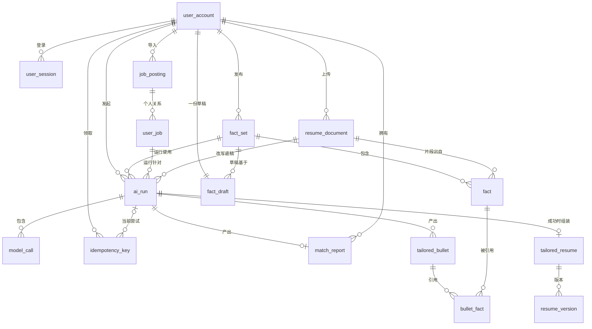

# JobPilot 数据库设计速查

日期：2026-11-24。随迁移更新。

本页汇总**已经建好**的表，方便回顾。设计以 [02 第 5 节](./02-技术架构与数据模型.md#5-数据模型)为准，实际结构以代码为准：

| 想看什么 | 去哪里 |
| --- | --- |
| 表和字段的实际定义 | [jobpilot/db/models.py](../../jobpilot/db/models.py) |
| 每次结构变更 | [jobpilot/alembic/versions/](../../jobpilot/alembic/versions/)，文件名以日期开头 |
| 还没建的表（岗位、对话、记忆等） | [02 第 5.1 节](./02-技术架构与数据模型.md#51-v1-表) |
| 约束有没有真的生效 | `jobpilot/tests/test_fact_schema.py`、`test_model_call_schema.py`、`test_account_migration.py` |

## 1. 全景

目前 16 张表，分五组：账号、运行与模型调用、经历事实库、岗位与匹配报告、改写条目与定制简历。



不显示图时，可以看这个简图：

```
user_account ─┬─ user_session          登录
              ├─ idempotency_key       付费请求的原响应
              ├─ ai_run ─┬─ model_call 一次业务运行，及其中每次模型请求
              │          ├─ match_report 匹配报告，按 run_id 追溯快照与事实版本
              │          ├─ tailored_bullet ── bullet_fact  改写条目 → 引用的事实
              │          └─ tailored_resume ── resume_version 完整简历 → 每次保存的版本
              ├─ resume_document ─┐     简历原文
              ├─ fact_set ────────┼── fact   版本 → 事实；事实的片段指向原文
              ├─ fact_draft       ┘          草稿基于某个版本
              └─ job_posting ── user_job       JD 原文与解析 → 个人的进度与修改
```

## 2. 每张表的完整结构

下面按表列出全部字段、约束和索引，与 `db/models.py` 一致。表格里的写法：

- **可空**：「否」表示 `NOT NULL`，必须有值。
- **默认**：`uuid4()` 由程序生成；`now()`、`false`、`'[]'` 这些由数据库填写。
- 每张表都有 `created_at`（带时区的时间，默认 `now()`），下面不再重复列出。
- 时间类型都是 `TIMESTAMPTZ`（`TIMESTAMP WITH TIME ZONE`），存的是绝对时间，不受服务器时区影响。

### 2.1 `user_account` 账号

| 字段 | 类型 | 可空 | 默认 | 说明 |
| --- | --- | --- | --- | --- |
| `user_id` | UUID | 否，主键 | `uuid4()` | 用户 ID，所有业务表都用它表示归属 |
| `email` | VARCHAR(320) | 否 | | 登录邮箱，写入前统一转小写；320 是邮箱的最大长度 |
| `hashed_password` | TEXT | 否 | | argon2 哈希，不存明文密码 |
| `deletion_requested_at` | TIMESTAMPTZ | 是 | | 申请删除的时间；不为空表示在 7 天待删除期，只能恢复或登出 |

| 约束 / 索引 | 内容 | 为什么 |
| --- | --- | --- |
| `uq_user_account_email_lower` | 对 `lower(email)` 的唯一索引 | `A@x.com` 和 `a@x.com` 不能注册成两个账号 |

### 2.2 `user_session` 登录记录

| 字段 | 类型 | 可空 | 默认 | 说明 |
| --- | --- | --- | --- | --- |
| `session_id` | UUID | 否，主键 | `uuid4()` | |
| `user_id` | UUID | 否 | | 外键 → `user_account`，删除账号时级联删除 |
| `token_hash` | VARCHAR(64) | 否 | | 登录 token 的 SHA-256 十六进制摘要（64 个字符） |
| `expires_at` | TIMESTAMPTZ | 否 | | 过期时间，默认登录 7 天 |

| 约束 / 索引 | 内容 | 为什么 |
| --- | --- | --- |
| 唯一 `token_hash` | | 每次请求按摘要查登录记录，必须唯一 |
| `ix_user_session_user_id` | `user_id` | 按用户查登录记录，例如申请删除账号时注销全部登录 |

### 2.3 `ai_run` 业务运行

一次解析简历、解析 JD、匹配、改写或对话，就是一次运行。模型调用和产物都挂在运行下面。

| 字段 | 类型 | 可空 | 默认 | 说明 |
| --- | --- | --- | --- | --- |
| `run_id` | UUID | 否，主键 | `uuid4()` | |
| `user_id` | UUID | 否 | | 外键 → `user_account`，级联删除 |
| `kind` | VARCHAR(32) | 否 | | `parse_resume`、`parse_jd`、`match`、`tailor`、`agent` 之一 |
| `status` | VARCHAR(32) | 否 | `running` | `running`、`waiting_confirmation` 为进行中；`succeeded`、`failed`、`cancelled`、`budget_exhausted` 为终态 |
| `thread_id` | TEXT | 是 | | 用到 LangGraph 时的检查点 ID，第 2 周起使用 |
| `fact_set_id` | UUID | 是 | | 这次运行使用的事实库版本 |
| `user_job_id` | UUID | 是 | | 解析 JD 的运行关联产出的岗位；匹配和改写关联所针对的岗位 |
| `job_snapshot_json` | JSONB | 是 | | 匹配和改写开始时固定的岗位快照（已合并个人修改） |
| `base_doc_id` | UUID | 是 | | 改写启动时固定的简历底稿；基本信息、教育等不改写的内容从这里原样保留 |
| `stop_reason` | VARCHAR(32) | 是 | | 没有成功结束的原因：`budget_exhausted`、`match_failed`、`rewrite_failed`、`service_restarted`；只能出现在已结束的运行上 |
| `plan_json` | JSONB | 是 | | 改写计划和每块的结果（`done`、`interrupted`、`failed`、`not_started`）。预算用完时查询接口据此说明哪几块没写完，不读 LangGraph 检查点 |
| `started_at` | TIMESTAMPTZ | 否 | `now()` | |
| `finished_at` | TIMESTAMPTZ | 是 | | 进入终态的时间 |

| 约束 / 索引 | 内容 | 为什么 |
| --- | --- | --- |
| 唯一 `(run_id, user_id)` | | 供 `model_call` 用两列引用，保证调用记录和运行属于同一用户 |
| `ck_ai_run_kind`、`ck_ai_run_status` | 取值范围 | 拼错的类型和状态写不进去 |
| `ck_ai_run_finished_at` | 进行中 ⇔ `finished_at` 为空 | 状态和结束时间不会互相矛盾 |
| `ck_ai_run_stop_reason` | 停止原因取值范围，且只在已结束的运行上 | 进行中的运行不会带着「已停止」的原因；所以写停止原因要放在取得终态之后 |
| 组合外键 `(fact_set_id, user_id)` → `fact_set` | 提交时检查 | 运行只能使用自己的事实库版本 |
| 组合外键 `(user_job_id, user_id)` → `user_job` | 提交时检查 | 运行只能针对自己的岗位 |
| 组合外键 `(base_doc_id, user_id)` → `resume_document` | 提交时检查 | 改写只能用自己的简历做底稿 |
| `uq_ai_run_run_id_user_id_fact_set_id` | 唯一 `(run_id, user_id, fact_set_id)` | 供改写条目用三列引用，保证条目用的是运行启动时固定的事实库版本 |
| `ix_ai_run_user_id_started_at` | `(user_id, started_at)` | 按用户、按时间列出运行 |

### 2.4 `model_call` 模型调用

每次实际发给模型的请求一行，重试和 JSON 修复各记一行。

| 字段 | 类型 | 可空 | 默认 | 说明 |
| --- | --- | --- | --- | --- |
| `call_id` | UUID | 否，主键 | `uuid4()` | |
| `run_id` | UUID | 是 | | 所属运行；运行删除后置空 |
| `user_id` | UUID | 是 | | 所属用户；和 `run_id` 一起置空 |
| `purpose` | VARCHAR(32) | 否 | | 用途，如 `extract_facts`、`parse_jd` |
| `model` | TEXT | 否 | | 模型名，如 `deepseek-flash` |
| `prompt_version` | TEXT | 是 | | 如 `extract_facts@4`；修复重发记为 `extract_facts@4+repair_json@1` |
| `outcome` | VARCHAR(32) | 否 | | `unknown`（发出后没拿到响应）、`success`、`invalid_output`、`http_error` |
| `latency_ms` | INTEGER | 是 | | 耗时（毫秒） |
| `prompt_tokens` | INTEGER | 是 | | 输入 token |
| `completion_tokens` | INTEGER | 是 | | 输出 token |

| 约束 / 索引 | 内容 | 为什么 |
| --- | --- | --- |
| 组合外键 `(run_id, user_id)` → `ai_run`，`ON DELETE SET NULL` | | 删除运行或账号后，调用记录去掉归属、匿名保留，成本统计不丢 |
| `ck_model_call_run_ownership` | `run_id` 和 `user_id` 同时为空或同时有值 | 不会出现只剩一半归属的记录 |
| `ck_model_call_unknown_usage` | `outcome` 为 `unknown` 时用量必须为空 | 没拿到响应就不知道用了多少，不能填 0 |
| `ck_model_call_latency_ms` 等 | 耗时和 token 不能为负 | |
| `ix_model_call_run_id_user_id` | `(run_id, user_id)` | 查一次运行的全部调用 |
| `ix_model_call_user_id_created_at` | `(user_id, created_at)` | 按用户统计用量 |

发送前先插入一行（`outcome = unknown`，用量为空），收到响应后再更新。两步各用一个独立的短事务，业务事务回滚也不会丢掉调用记录。

### 2.5 `resume_document` 简历原文

| 字段 | 类型 | 可空 | 默认 | 说明 |
| --- | --- | --- | --- | --- |
| `doc_id` | UUID | 否，主键 | `uuid4()` | |
| `user_id` | UUID | 否 | | 外键 → `user_account`，级联删除 |
| `filename` | TEXT | 是 | | 上传的文件名；粘贴文本时为空 |
| `raw_text` | TEXT | 否 | | 用户核对后的全文，事实的片段和位置都按它计算 |
| `sections_json` | JSONB | 否 | `'[]'` | 分段，每段 `{"name", "section", "start", "end"}`，`raw_text[start:end]` 是这一段 |

| 约束 / 索引 | 内容 | 为什么 |
| --- | --- | --- |
| 唯一 `(doc_id, user_id)` | | 供 `fact` 用两列引用，事实只能引用自己的简历 |
| `ix_resume_document_user_id_created_at` | `(user_id, created_at)` | 按时间列出用户上传过的简历，取最近一份 |

原文件解析后不保存，只保存核对后的文字。

### 2.6 `fact_set` 事实库版本

| 字段 | 类型 | 可空 | 默认 | 说明 |
| --- | --- | --- | --- | --- |
| `fact_set_id` | UUID | 否，主键 | `uuid4()` | |
| `user_id` | UUID | 否 | | 外键 → `user_account`，级联删除 |
| `version` | INTEGER | 否 | | 版本号，同一用户从 1 开始递增 |

| 约束 / 索引 | 内容 | 为什么 |
| --- | --- | --- |
| 唯一 `(user_id, version)` | | 两个窗口同时发布时，只有一个能拿到下一个版本号，另一个失败 |
| 唯一 `(fact_set_id, user_id)` | | 供事实、草稿、运行用两列引用 |
| `ck_fact_set_version` | `version >= 1` | |

### 2.7 `fact` 事实

| 字段 | 类型 | 可空 | 默认 | 说明 |
| --- | --- | --- | --- | --- |
| `fact_id` | UUID | 否，主键 | `uuid4()` | 某个版本里的一行 |
| `fact_set_id` | UUID | 否 | | 属于哪个版本 |
| `user_id` | UUID | 否 | | 归属用户 |
| `lineage_id` | UUID | 否 | | 跨版本的同一条事实，修订时沿用 |
| `experience` | TEXT | 否 | | 所属经历，如「禾栈仓储软件 后端开发实习」 |
| `section` | VARCHAR(16) | 是 | | 简历栏目：`education`、`project`、`internship`、`skill`、`award`、`other`；改写按栏目分块。用户补充的事实和 2026-11-24 之前发布的事实为空 |
| `kind` | VARCHAR(16) | 否 | | `action`、`technology`、`result`、`role` |
| `responsibility` | VARCHAR(16) | 否 | | `lead`、`own`、`participate`、`na` |
| `text` | TEXT | 否 | | 事实内容（转述） |
| `has_number` | BOOLEAN | 否 | | 是否含数字，依据检查对数字严格比对 |
| `source` | VARCHAR(16) | 否 | | `resume`（简历拆出）或 `user`（用户补充或纠正） |
| `source_doc_id` | UUID | 是 | | 出自哪份简历；用户补充的为空 |
| `source_quote` | TEXT | 是 | | 原文片段 |
| `span_start`、`span_end` | INTEGER | 是 | | 片段在原文中的位置，`raw_text[span_start:span_end] == source_quote` |
| `quote_verified` | BOOLEAN | 否 | `false` | 原文校验是否通过 |

| 约束 / 索引 | 内容 | 为什么 |
| --- | --- | --- |
| 组合外键 `(fact_set_id, user_id)` → `fact_set`，级联删除 | | 事实只能挂在自己的版本上 |
| 组合外键 `(source_doc_id, user_id)` → `resume_document`，提交时检查 | | 事实只能引用自己的简历；删除账号时不会误报 |
| 唯一 `(user_id, fact_set_id, lineage_id)` | | 同一版本里，同一条事实只出现一次 |
| 唯一 `(fact_id, user_id, fact_set_id)` | | 供 `bullet_fact` 用三列引用，保证条目引用的是同一用户、同一版本的事实 |
| `ck_fact_kind`、`ck_fact_responsibility`、`ck_fact_section` | 取值范围 | |
| `ck_fact_source` | 简历来源：出处四项都有值，且校验通过；用户来源：出处四项都为空 | 没通过原文校验的事实，数据库层面就发布不了 |
| `ck_fact_span` | 位置为空，或 `0 <= span_start < span_end` | |
| 触发器 `fact_append_only` | 拒绝任何 UPDATE | 已发布的事实不能修改，只能发布新版本 |

### 2.8 `fact_draft` 草稿

| 字段 | 类型 | 可空 | 默认 | 说明 |
| --- | --- | --- | --- | --- |
| `user_id` | UUID | 否，主键 | | 外键 → `user_account`，级联删除；主键就是用户，所以每人只有一份草稿 |
| `base_fact_set_id` | UUID | 是 | | 草稿基于哪个版本；第一次发布前为空 |
| `revision` | INTEGER | 否 | `0` | 草稿修订号，成功写入一次加 1 |
| `items_json` | JSONB | 否 | `'[]'` | 草稿条目列表，结构见下 |
| `updated_at` | TIMESTAMPTZ | 否 | `now()` | 每次修改时更新 |

| 约束 / 索引 | 内容 | 为什么 |
| --- | --- | --- |
| 组合外键 `(base_fact_set_id, user_id)` → `fact_set`，提交时检查 | | 草稿只能基于自己的版本 |

`items_json` 里每个条目是一个 `DraftItem`（见 `services/drafts.py`），2026-11-23 定：

| 字段 | 说明 |
| --- | --- |
| `lineage_id` | 指代这条事实。已发布的沿用原有的，草稿里的新事实创建时分配 |
| `status` | `pending` 待确认（发布后仍留在草稿）、`confirmed` 已确认（进入下一版）、`deleted` 已发布的事实下一版移除 |
| `experience`、`section` | 所属经历、段落类型；用户补充的事实没有段落类型 |
| `kind`、`responsibility`、`text`、`has_number` | 与 `fact` 表相同 |
| `source`、`source_doc_id`、`source_quote`、`span_start`、`span_end`、`quote_verified` | 来源与出处，与 `fact` 表相同 |
| `review_reasons` | 需要用户核对的原因 |

发布时锁住草稿行，新版本 = 上一版里草稿没动过的事实（复制一行，`lineage_id` 不变）+ 已确认的条目，待确认的条目留在草稿。

2026-11-24 增加草稿修订号。新建、编辑、删除、批量操作、上传追加、发布在锁住当前用户的草稿行后统一推进修订号。草稿列表在 `draft.revision` 返回修订号，单条详情在响应顶层返回；尚无草稿时为 `0`。读取草稿和已发布版本使用同一查询快照，避免把发布前的内容和发布后的修订号一起显示。

替换和删除既有草稿项（事实、求职条件、教育）以及批量操作、发布一律要求 `expected_revision`，防止旧窗口删除或覆盖另一窗口刚确认或修改的草稿。服务在同一草稿行锁下核对，修订号过期时返回 `409`，当前草稿修订号在 `detail.revision`，草稿保持原样。发布还要核对 `base_fact_set_id`。写接口在 JSON 顶层返回本次事务写入的 `revision`，删除保留 `204` 并用 `X-Draft-Revision` 响应头返回。

### 2.9 `job_posting` 岗位原文与解析结果

| 字段 | 类型 | 可空 | 默认 | 说明 |
| --- | --- | --- | --- | --- |
| `posting_id` | UUID | 否，主键 | `uuid4()` | |
| `owner_id` | UUID | 是 | | 导入的用户；外键 → `user_account`，级联删除。V1 必填，以后公开岗位可为空 |
| `visibility` | VARCHAR(16) | 否 | `private` | `private` 或 `public`；V1 全部私有 |
| `raw_text` | TEXT | 否 | | 规范化后的 JD 正文 |
| `content_hash` | VARCHAR(64) | 否 | | 正文的 SHA-256，同一用户内去重 |
| `parsed_json` | JSONB | 否 | | 解析结果：`basic_fields`、`requirements`（每条带 `requirement_id`、类型、文字、原文片段与位置）、`duties`、`keywords` |
| `keywords` | JSONB | 否 | `'[]'` | 标准化后的关键词，单独存一列方便以后统计 |
| `injection_flags` | JSONB | 否 | `'[]'` | 注入检测命中的规则、文字和上下文 |

| 约束 / 索引 | 内容 | 为什么 |
| --- | --- | --- |
| 唯一 `(owner_id, content_hash)` | | 同一用户导入同一份 JD 只存一份；不同用户各自导入互不影响 |
| 唯一 `(posting_id, owner_id)` | | 供 `user_job` 用两列引用，岗位关系只能指向自己导入的岗位 |
| `ck_job_visibility`、`ck_job_owner` | 取值范围；私有岗位必须有主人 | |

用户对解析结果的修改不写这里，写 `user_job`，原始解析保持可追溯。

### 2.10 `user_job` 个人岗位

| 字段 | 类型 | 可空 | 默认 | 说明 |
| --- | --- | --- | --- | --- |
| `user_job_id` | UUID | 否，主键 | `uuid4()` | 接口路径里的 `job_id` 就是它 |
| `user_id` | UUID | 否 | | 外键 → `user_account`，级联删除 |
| `posting_id` | UUID | 否 | | 对应的岗位 |
| `stage` | VARCHAR(16) | 否 | `saved` | `saved`、`applied`、`interviewing`、`offer`、`rejected`、`archived` |
| `field_overrides_json` | JSONB | 否 | `'{}'` | 对解析结果的修改，`basic_fields`、`requirements`、`keywords` 给了哪项就整体替换哪项 |
| `extra_fields_json` | JSONB | 否 | `'{}'` | 自定义字段（MVP 未用） |
| `note` | TEXT | 是 | | 备注 |
| `updated_at` | TIMESTAMPTZ | 否 | `now()` | |

| 约束 / 索引 | 内容 | 为什么 |
| --- | --- | --- |
| 组合外键 `(posting_id, user_id)` → `job_posting(posting_id, owner_id)`，级联删除 | | 只能关联自己导入的岗位 |
| 唯一 `(user_id, posting_id)` | | 同一个岗位一个人只有一条关系 |
| 唯一 `(user_job_id, user_id)` | | 供运行、投递等用两列引用 |
| `ck_user_job_stage` | 取值范围 | |
| `ix_user_job_user_id_updated_at` | `(user_id, updated_at)` | 岗位库按最近更新排序 |

### 2.11 `match_report` 匹配报告

| 字段 | 类型 | 可空 | 默认 | 说明 |
| --- | --- | --- | --- | --- |
| `report_id` | UUID | 否，主键 | `uuid4()` | |
| `user_id` | UUID | 否 | | 归属用户；外键 → `user_account`，级联删除 |
| `run_id` | UUID | 否 | | 所属匹配运行；同用户组合外键追溯岗位快照与事实库版本 |
| `items_json` | JSONB | 否 | `'[]'` | 每条要求的匹配判断（`covered` / `expression_gap` / `partial` / `missing`）、引用事实 ID、理由与建议 |
| `main_gaps` | JSONB | 否 | `'[]'` | 模型提炼的主要短板列表 |

| 约束 / 索引 | 内容 | 为什么 |
| --- | --- | --- |
| `uq_match_report_run_id` | 唯一 `run_id` | 一次匹配运行只产出一份报告 |
| 组合外键 `(run_id, user_id)` → `ai_run`，级联删除 | | 报告只能挂在自己的运行上，删除运行或账号时级联清理 |
| `ix_match_report_user_id_created_at` | `(user_id, created_at)` | 按用户、按时间列出匹配报告 |

**2026-11-24 写入约定。** 同一用户的 `parse_resume` 运行也能满足现有组合外键，但匹配报告回读时需要事实库版本和岗位快照。V1 由 `add_match_report()` 统一校验运行类型为 `match`、事实库版本和岗位快照均存在。验收时，向同一用户的 `parse_resume` 运行写入报告应失败，缺少事实库版本或岗位快照也应失败。出现后台任务或数据回填等第二条写入路径时，再考虑匹配专表或带类型的组合外键，由 PostgreSQL 拒绝错误关联。

### 2.12 `tailored_bullet` 改写条目

一次改写运行产出的一条简历条目，经过三层依据检查。文字和引用生成后不再修改：用户在面板里修改，另存为简历版本；只有 `user_decision` 会在用户采纳或放弃时写入。

| 字段 | 类型 | 可空 | 默认 | 说明 |
| --- | --- | --- | --- | --- |
| `bullet_id` | UUID | 否，主键 | `uuid4()` | |
| `run_id` | UUID | 否 | | 所属改写运行 |
| `user_id` | UUID | 否 | | 归属用户；外键 → `user_account`，级联删除 |
| `fact_set_id` | UUID | 否 | | 运行固定的事实库版本 |
| `section` | VARCHAR(16) | 否 | | `experience`（写在某段经历下）或 `skills`（技能概述，可以引用多段经历） |
| `experience` | TEXT | 是 | | 经历条目所属的经历名；技能概述为空 |
| `order_no` | INTEGER | 否 | | 在简历中的顺序 |
| `text` | TEXT | 否 | | 条目文字 |
| `check_status` | VARCHAR(16) | 否 | | `passed`（三层通过，可能修订过）、`fallback`（修订两次仍不通过，退回事实原文）、`pending`（没有可用事实，标「待处理」） |
| `revision_count` | INTEGER | 否 | `0` | 修订次数，0～2 |
| `issues_json` | JSONB | 否 | `'[]'` | 最后一次检查的问题清单 |
| `user_decision` | VARCHAR(16) | 是 | | 用户的处理：`accepted`、`rejected` |

| 约束 / 索引 | 内容 | 为什么 |
| --- | --- | --- |
| 组合外键 `(run_id, user_id, fact_set_id)` → `ai_run`，级联删除 | | 条目只能挂在自己的运行上，而且事实库版本必须是运行启动时固定的那个 |
| 唯一 `(bullet_id, user_id, fact_set_id)` | | 供 `bullet_fact` 用三列引用 |
| `ck_tailored_bullet_experience` | `section = 'experience'` ⇔ `experience` 不为空 | 经历条目必须写明是哪段经历，技能概述不能有 |
| `ck_tailored_bullet_section`、`ck_tailored_bullet_check_status`、`ck_tailored_bullet_user_decision`、`ck_tailored_bullet_order_no`、`ck_tailored_bullet_revision_count` | 取值范围 | |
| `uq_tailored_bullet_run_id` | 唯一 `(run_id, order_no)` | 同一次运行里顺序号不重复；自带的索引用来按顺序读出全部条目 |

### 2.13 `bullet_fact` 条目引用的事实

| 字段 | 类型 | 可空 | 默认 | 说明 |
| --- | --- | --- | --- | --- |
| `bullet_id` | UUID | 否，主键之一 | | |
| `fact_id` | UUID | 否，主键之一 | | |
| `user_id` | UUID | 否 | | 外键 → `user_account`，级联删除 |
| `fact_set_id` | UUID | 否 | | 和条目、事实的版本相同 |

| 约束 / 索引 | 内容 | 为什么 |
| --- | --- | --- |
| 主键 `(bullet_id, fact_id)` | | 同一条目不重复引用同一事实 |
| 组合外键 `(bullet_id, user_id, fact_set_id)` → `tailored_bullet`，级联删除 | | |
| 组合外键 `(fact_id, user_id, fact_set_id)` → `fact`，级联删除 | | 两个外键共用 `user_id` 和 `fact_set_id`，所以条目只能引用同一用户、同一版本的事实：引用新版本的事实、别人的事实，数据库都会拒绝 |

### 2.14 `idempotency_key` 付费请求重放

`POST /api/resumes`、`POST /api/jobs`、`POST /api/jobs/{job_id}/match` 和 `POST /api/jobs/{job_id}/tailor` 必须带一个 `Idempotency-Key` 请求头，缺少或无效返回 `400`。同用户、同操作和同键的请求比较指纹。指纹由已校验的 JSON 正文或匹配岗位路径 ID 计算，内容不同返回 `422`，正在处理返回 `409`。已成功返回第一次的响应体和状态码，包含当时的草稿修订号或岗位字段。已失败可以用相同请求再次尝试，主动重新解析时使用新键。岗位正文哈希查重依然生效，命中时保存并重放 `200`。

| 字段 | 类型 | 可空 | 说明 |
| --- | --- | --- | --- |
| `user_id` | UUID | 否 | 主键之一；外键 → `user_account`，级联删除 |
| `operation` | VARCHAR(32) | 否 | 主键之一；`parse_resume`、`parse_jd`、`match`、`tailor` |
| `key` | VARCHAR(255) | 否 | 主键之一；客户端为一次提交选择的键 |
| `request_hash` | VARCHAR(64) | 否 | 请求指纹，SHA-256 十六进制摘要 |
| `attempt_id` | UUID | 否 | 当前执行尝试，重试时换新 |
| `run_id` | UUID | 是 | 当前或最近一次实际运行；组合外键 `(run_id, user_id)`，级联删除；直接命中岗位查重时可空 |
| `status` | VARCHAR(16) | 否 | `processing`、`succeeded`、`failed` |
| `result_id` | UUID | 是 | 按操作保存文档、个人岗位或报告 ID；简历拆分失败时保留文档 ID，重试复用原文 |
| `response_status` | INTEGER | 是 | 成功时为 `200`、`201`，或启动改写的 `202`（运行已创建、在后台执行；之后运行失败，同一键仍返回这个运行） |
| `response_body` | TEXT | 是 | 成功时保存原始 JSON 响应；随账号清理 |

用独立短事务领取键，随真实运行首次提交关联 `run_id`。模型调用期间没有幂等键锁。成功快照和产物、运行终态一起提交。文件文字提取 `POST /api/resumes/extract` 只在本地解析，沿用原调用方式。

如果进程在模型服务方收到请求后崩溃，本地无法证明对方是否计费。网关保留 `model_call.outcome = unknown` 和空用量。单进程服务重启时把遗留的 `processing` 键标为失败，包括尚未关联运行的键。客户端显式重试会发起新尝试，可能产生一笔新的计费。多进程部署前需按进程或租约识别遗留请求。

### 2.15 `tailored_resume` 定制简历

一次成功的改写运行组装出一份完整简历（底稿原样保留的部分加改写条目）。只在运行成功的事务里创建；预算用完、失败时没有。

| 字段 | 类型 | 可空 | 默认 | 说明 |
| --- | --- | --- | --- | --- |
| `resume_id` | UUID | 否，主键 | `uuid4()` | |
| `run_id` | UUID | 否 | | 产出它的改写运行；组合外键 `(run_id, user_id)` → `ai_run`，级联删除 |
| `user_id` | UUID | 否 | | 外键 → `user_account`，级联删除 |
| `current_version_id` | UUID | 否 | | 当前版本 |

| 约束 | 内容 | 为什么 |
| --- | --- | --- |
| 唯一 `run_id` | | 一次改写只产出一份简历；finalize 重复执行也不会多出一份 |
| 唯一 `(resume_id, user_id)` | | 供版本表用两列引用，版本只能挂在本人的简历上 |
| 组合外键 `(current_version_id, resume_id)` → `resume_version` | 提交时检查 | 当前版本只能是这份简历自己的版本。两表互相引用，同一事务先写简历再写版本，所以延到提交时检查 |

### 2.16 `resume_version` 简历版本

首次组装是 v1，每次保存编辑新增一行，旧版本保留，可按版本号读回。

| 字段 | 类型 | 可空 | 说明 |
| --- | --- | --- | --- |
| `resume_version_id` | UUID | 否，主键 | |
| `resume_id` | UUID | 否 | 组合外键 `(resume_id, user_id)` → `tailored_resume`，级联删除，提交时检查 |
| `user_id` | UUID | 否 | 外键 → `user_account`，级联删除 |
| `version` | INTEGER | 否 | 从 1 开始；`(user_id, resume_id, version)` 唯一 |
| `content_json` | JSONB | 否 | 页头、栏目、经历和条目（`services/resume_content.py` 的 `ResumeContent`）。每条改写记着引用的事实、生成结果、是否手改过，以及依据检查的结论和**它检查的那段文字** |

检查结论跟文字绑在一起保存：文字改了而结论没跟上时，界面显示「待检查」，不会让旧的通过标记落在新句子上。保存编辑时锁住简历行，核对请求里的 `base_version_id` 仍是当前版本，否则返回 409；新版本和指针移动在同一事务。条目引用哪些事实以上一版为准，客户端改不了。

**检查结论绑定位置（2026-11-25）。** 条目只能在原来的经历里改字：条目换了所属经历、同一经历出现两次、经历换了栏目，保存都返回 422。否则把实习 A 已通过的条目挪到项目 B，文字没变，旧的「通过」会被沿用，导出后 A 的成果挂在 B 名下。栏目类型和经历名取上一版，不信请求。重置由服务端把第一版复制成新版本，不走普通保存（普通保存会把第一版里、当前版已删掉的条目当成不认识的条目拒绝）。

## 3. 贯穿所有表的设计

1. **每张业务表都有 `user_id`，接口只从登录态取它。** 查询都带 `user_id`，查不到就返回 404。接口不接受请求体里的 `user_id`。
2. **组合外键防止跨用户引用。** 例如 `fact` 用 `(fact_set_id, user_id)` 引用 `fact_set`，而不是只用 `fact_set_id`：就算程序写错，数据库也不允许把 A 的事实挂到 B 的版本上。被引用的表因此要有 `(id, user_id)` 的唯一约束。
3. **只追加加版本快照。** 事实不改不删，每次发布生成新的 `fact_set`。好处：改写结果可以记录「基于哪个版本」，回看投递时的简历依据什么事实，也能看出哪条事实被改过。
4. **数据库替程序守底线。** 能用约束表达的规则都写成约束（CHECK、唯一、外键、触发器），程序出错时数据库拒绝写入，而不是悄悄存进错误数据。
5. **删除账号时级联删除。** 用户的数据随账号一起删除（`ON DELETE CASCADE`）。互相引用、又不级联的组合外键设为「提交时才检查」（`DEFERRABLE INITIALLY DEFERRED`）：同一个事务里原文和事实都会被删掉，如果立即检查，删到一半就会误报「原文仍被引用」。
6. **共同字段。** 所有表都有 `created_at`，由数据库填写；约束和索引按统一的规则命名（见 `db/base.py`）。

## 4. 迁移记录

| 迁移 | 内容 |
| --- | --- |
| `20261116_01` | 启用 pgvector 扩展；账号和登录 session |
| `20261118_01` | 业务运行和模型调用；运行删除后调用记录匿名保留 |
| `20261118_02` | 账号表改名为 `user_account` 并统一小写邮箱；发送前先记账（结果为 unknown）；运行终态与结束时间的校验 |
| `20261120_01` | 模型调用记录提示词版本；JSON 修复重发时记下两份提示词的版本 |
| `20261121_01` | 简历原文、事实库版本、事实、草稿；事实只追加的触发器；运行关联事实库版本 |
| `20261123_01` | 岗位原文与解析结果、个人岗位；运行关联岗位 |
| `20261123_02` | 运行补齐 `job_snapshot_json` 岗位快照；新增匹配报告表 `match_report` |
| `20261124_01` | 事实补栏目 `section`；运行记录简历底稿 `base_doc_id`；新增改写条目 `tailored_bullet` 和条目引用事实 `bullet_fact`。给 `fact` 加列和约束不改已有行，不会触发拒绝 UPDATE 的触发器，已在有事实数据的测试库上验证，旧事实的栏目为空 |
| `20261124_02` | 运行加 `stop_reason` 和 `plan_json`，停止原因只允许在已结束的运行上。测试库升级、回退、再升级通过，`alembic check` 无差异 |
| `20261124_03` | `fact_draft.revision` 使用数据库默认值 `0` 初始化已有草稿。已在含草稿和已发布事实的测试库上验证升级、回退和再次升级，条目和事实保留，事实只追加触发器仍生效 |
| `20261124_04` | 新增 `idempotency_key`，无历史数据回填。在已有发布事实和草稿的测试库验证回退及再次升级，原数据和事实只追加触发器保留，`alembic check` 通过 |
| `20261124_06` | 新增 `tailored_resume` 和 `resume_version`。两表互相引用：先建两张表，再加当前版本指针的外键，两个外键都在提交时检查。测试库升级、回退、再升级通过，`alembic check` 无差异 |
| `20261124_05` | 幂等键的操作类型加 `tailor`，成功响应允许 `202`。回退时先删掉改写的键（旧约束容不下，删后客户端重送会新建运行）。测试库升级、回退、再升级通过，`alembic check` 无差异 |

数据库里还有一张 `alembic_version`，只有一行，记录当前执行到哪一次迁移，是 Alembic 自己用的。

2026-11-23 核对：开发库的 11 张业务表（账号 2、运行与调用 2、简历与事实库 4、岗位与匹配 3）与 `db/models.py` 的字段和可空性一致，触发器 `fact_append_only` 存在。

## 5. 自检问题

1. 为什么 `fact` 引用 `fact_set` 要用 `(fact_set_id, user_id)` 两列，而不是只用 `fact_set_id`？
2. 用户把一条事实从 30% 改成 20%，数据库里会多出什么、哪些行保持不变？
3. 为什么 `user_session` 只存 token 的摘要？
4. 删除账号时，为什么有些外键要延迟到提交时才检查？
5. `fact_draft` 的主键为什么是 `user_id`？
