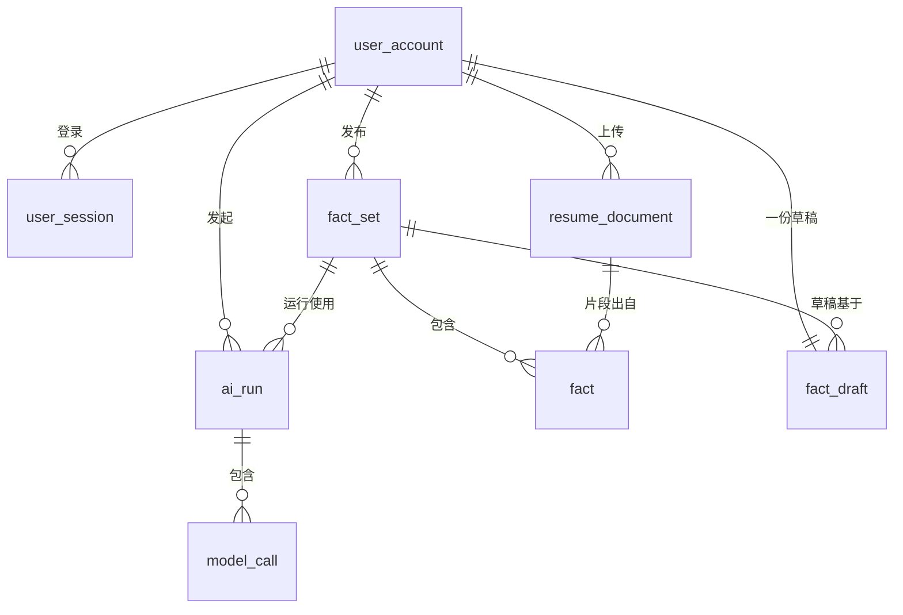

# JobPilot 数据库设计速查

日期：2026-11-23。随迁移更新。

本页汇总**已经建好**的表，方便回顾。设计以 [02 第 5 节](./02-技术架构与数据模型.md#5-数据模型)为准，实际结构以代码为准：

| 想看什么 | 去哪里 |
| --- | --- |
| 表和字段的实际定义 | [jobpilot/db/models.py](../../jobpilot/db/models.py) |
| 每次结构变更 | [jobpilot/alembic/versions/](../../jobpilot/alembic/versions/)，文件名以日期开头 |
| 还没建的表（岗位、对话、记忆等） | [02 第 5.1 节](./02-技术架构与数据模型.md#51-v1-表) |
| 约束有没有真的生效 | `jobpilot/tests/test_fact_schema.py`、`test_model_call_schema.py`、`test_account_migration.py` |

## 1. 全景

目前 8 张表，分三组：账号、运行与模型调用、经历事实库。



不显示图时，可以看这个简图：

```
user_account ─┬─ user_session          登录
              ├─ ai_run ── model_call   一次业务运行，及其中每次模型请求
              ├─ resume_document ─┐     简历原文
              ├─ fact_set ────────┼── fact   版本 → 事实；事实的片段指向原文
              └─ fact_draft       ┘          草稿基于某个版本
```

## 2. 每张表

### 账号

| 表 | 存什么 | 关键约束与原因 |
| --- | --- | --- |
| `user_account` | 邮箱、argon2 密码哈希、`deletion_requested_at`（不为空表示在 7 天待删除期） | 对 `lower(email)` 建唯一索引：`A@x.com` 和 `a@x.com` 是同一个账号 |
| `user_session` | 登录 token 的 SHA-256 摘要、过期时间 | 只存摘要不存 token：数据库泄露也拿不到能用的登录凭证 |

### 运行与模型调用

| 表 | 存什么 | 关键约束与原因 |
| --- | --- | --- |
| `ai_run` | 一次业务运行：类型（解析简历、解析 JD、匹配、改写、对话）、状态、使用的事实库版本 | 状态是终态时 `finished_at` 必须有值，进行中时必须为空，用 CHECK 保证两者不会不一致 |
| `model_call` | 每次实际发给模型的请求：用途、提示词版本、结果、耗时、token | 运行删除后 `run_id`、`user_id` 一起置空，匿名保留统计；结果为 unknown 时用量必须为空（没拿到响应就不知道用了多少） |

### 经历事实库

| 表 | 存什么 | 关键约束与原因 |
| --- | --- | --- |
| `resume_document` | 用户核对后的简历全文 `raw_text`、分段 `sections_json` | 原文件解析后不保存；事实的片段和位置都以这里的文字为准 |
| `fact_set` | 事实库的一个版本：v1、v2、v3…… | `(user_id, version)` 唯一：同一个用户不会出现两个 v3 |
| `fact` | 已发布的原子事实 | **只追加**：触发器拒绝 UPDATE，修改就发布新版本；简历来源的事实必须带通过校验的片段和位置，用户补充的事实不带出处 |
| `fact_draft` | 每个用户一份草稿：待确认、修改、删除的条目放在 `items_json` | 主键就是 `user_id`，所以每人只有一份；`base_fact_set_id` 记录草稿基于哪个版本，发布时用来发现冲突 |

`fact` 表里两个 ID 的区别：

| 字段 | 含义 | 例子 |
| --- | --- | --- |
| `fact_id` | 某个版本里的一行 | v1 里「降低 30%」是一行，v2 里「降低 20%」是另一行，两个 `fact_id` 不同 |
| `lineage_id` | 跨版本的同一条事实 | 上面两行共用一个 `lineage_id`，表示后者是前者的修订 |

## 3. 贯穿所有表的设计

1. **每张业务表都有 `user_id`，接口只从登录态取它。** 查询都带 `user_id`，查不到就返回 404。接口不接受请求体里的 `user_id`。
2. **组合外键防止跨用户引用。** 例如 `fact` 用 `(fact_set_id, user_id)` 引用 `fact_set`，而不是只用 `fact_set_id`：就算程序写错，数据库也不允许把 A 的事实挂到 B 的版本上。被引用的表因此要有 `(id, user_id)` 的唯一约束。
3. **只追加加版本快照。** 事实不改不删，每次发布生成新的 `fact_set`。好处：改写结果可以记录「基于哪个版本」，回看投递时的简历依据什么事实，也能看出哪条事实被改过。
4. **数据库替程序守底线。** 能用约束表达的规则都写成约束（CHECK、唯一、外键、触发器），程序出错时数据库拒绝写入，而不是悄悄存进错误数据。
5. **删除账号时级联删除。** 用户的数据随账号一起删除（`ON DELETE CASCADE`）。互相引用、又不级联的组合外键设为「提交时才检查」（`DEFERRABLE INITIALLY DEFERRED`）：同一个事务里原文和事实都会被删掉，如果立即检查，删到一半就会误报「原文仍被引用」。
6. **共同字段。** 所有表都有 `created_at`，由数据库填写；约束和索引按统一的规则命名（见 `db/base.py`）。

## 4. 迁移记录

| 迁移 | 内容 |
| --- | --- |
| `20261116_01` | 启用 pgvector 扩展；账号和登录 session |
| `20261118_01` | 业务运行和模型调用；运行删除后调用记录匿名保留 |
| `20261118_02` | 账号表改名为 `user_account` 并统一小写邮箱；发送前先记账（结果为 unknown）；运行终态与结束时间的校验 |
| `20261120_01` | 模型调用记录提示词版本；JSON 修复重发时记下两份提示词的版本 |
| `20261121_01` | 简历原文、事实库版本、事实、草稿；事实只追加的触发器；运行关联事实库版本 |

## 5. 自检问题

1. 为什么 `fact` 引用 `fact_set` 要用 `(fact_set_id, user_id)` 两列，而不是只用 `fact_set_id`？
2. 用户把一条事实从 30% 改成 20%，数据库里会多出什么、哪些行保持不变？
3. 为什么 `user_session` 只存 token 的摘要？
4. 删除账号时，为什么有些外键要延迟到提交时才检查？
5. `fact_draft` 的主键为什么是 `user_id`？
